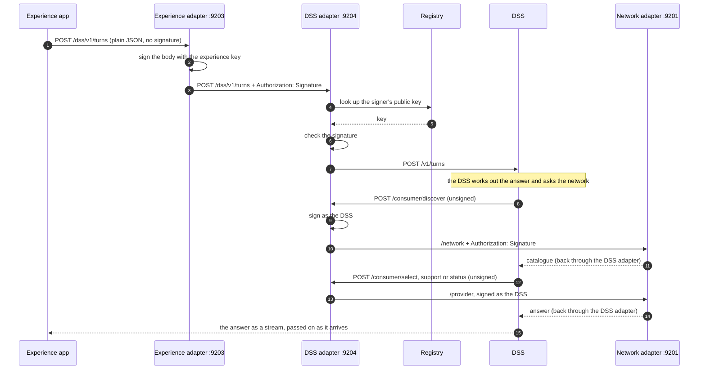
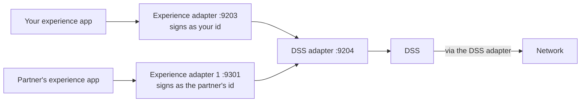

# Adapters for experience and the DSS

This guide shows how to connect your own experience app to the DSS (decision
support system) that already runs. It sets up two adapters between them. The
experience adapter signs your app's calls to the DSS. The DSS adapter checks
that signature against the registry before the DSS sees the call, and signs the
DSS's own calls to the network.

It covers:

- setting up the experience adapter and the DSS adapter,
- checking that a call goes through both,
- connecting a second experience app to the same DSS adapter.

This is the quick-start on one machine. Your experience app, the DSS and the
network each get their own entry in the registry. It is a way to try the flow,
not a production runbook.

## Before you start

Your experience app and the DSS run outside this stack. This guide sets up only
the two adapters between them, so both must already work on their own.

> **Note:** this quick-start does not include an experience app or the DSS. It
> has no service for either, so you bring your own.

You also need an adapter image that includes the `nonbecknrouter` plugin and the
`streamResponses` option.

Start from the [README](README.md#run-it). Follow it until the network adapter
is running and your network is registered, then come back here.

---

## The request flow

One turn, from your experience app to the DSS and out to the network and back.



Steps 1 to 7 are the call into the DSS. Steps 8 to 14 are the DSS's own calls
to the network. The network adapter checks the DSS adapter's signature the same
way the DSS adapter checked the experience adapter's. Answers come back the way
the call went, through both adapters.

Your experience app sends the DSS an ordinary request. It does not sign and it
does not send Beckn. The experience adapter does the signing.

## Set up the adapters

### 1. Settings

`.env` is the file you made from `.env.example`. In the quick-start `.env`, find
the block headed "Experience and DSS adapters (optional)", remove the `#` from
the lines you need and fill in the values. The other two places are outside this
stack: your experience app's own environment and the DSS's own environment.

| Where to set it | Setting | Value |
|---|---|---|
| quick-start `.env` | `EXPERIENCE_ADAPTER_IMAGE` | that image |
| quick-start `.env` | `EXPERIENCE_SUBSCRIBER_ID` | the id your experience app's requests are signed as, and the `senderId` it sends |
| quick-start `.env` | `DSS_SUBSCRIBER_ID` | the id the DSS calls the network as |
| quick-start `.env` | `DSS_URL` | where the DSS listens, as the adapter container sees it, e.g. `http://host.docker.internal:8077` |
| quick-start `.env` (optional) | `DSS_ADAPTER_URL` | where the experience adapter finds the DSS adapter, no trailing slash. Unset, it defaults to `http://dss-adapter:9204`, right when both run in this stack |
| your experience app | the address it sends turns to: its own experience adapter | `http://localhost:9203/dss` |
| your experience app | the `senderId` it sends | your `EXPERIENCE_SUBSCRIBER_ID` |
| the DSS | `DSS_DISCOVERY_BASE_URL` | `http://localhost:9204/consumer` |
| the DSS | `DSS_INVOCATION_BASE_URL` | `http://localhost:9204/consumer` |
| the DSS | `DSS_NETWORK_SENDER_ID` | your `DSS_SUBSCRIBER_ID` |
| the DSS | `DSS_NETWORK_HOST_ID` | your `BECKN_NETWORK_ID` |
| the DSS | `DSS_NETWORK_SENDER_FROM_TURN_ENABLED` | leave it off, which is the default |

Every `.env` setting except `DSS_ADAPTER_URL` must be set. Give the two ids
different values, and different from `BECKN_NETWORK_ID`. Each adapter is set up
on its own: the experience adapter needs no `DSS_URL`, and the DSS adapter needs
no `EXPERIENCE_SUBSCRIBER_ID`.

The addresses above use the default ports, 9203 for the experience adapter and
9204 for the DSS adapter. If you set `EXPERIENCE_ADAPTER_PORT` or
`DSS_ADAPTER_PORT` in `.env`, use those instead.

### 2. Register and start the adapters

```sh
make register-experience      # the experience adapter's entry, with its own keys
make configure-experience     # render its config and start it
make register-dss             # the DSS adapter's entry, with its own keys
make configure-dss            # render its config and start it
```

To see what an adapter is running, open its config in `config/adapters/experience/`:

| Adapter | Adapter config | Routing config |
|---|---|---|
| experience | `experience-adapter.yaml` | `routing-experience-adapter.yaml` |
| DSS | `dss-adapter.yaml` | `routing-dss-inbound.yaml` and `routing-dss-outbound.yaml` |

The adapter config holds the modules, plugins and steps. The routing config
holds where each path is sent. The `.yaml.tmpl` files beside them are the
templates the commands fill in. The rendered `.yaml` files hold the adapter's
private key, so do not share them.

### 3. Check it works

1. The two adapters should be running:

   ```sh
   make ps          # experience-adapter and dss-adapter are listed
   ```

2. Call the DSS adapter directly, with no signature. It should refuse:

   ```sh
   curl -i -X POST http://localhost:9204/dss/v1/turns \
     -H 'Content-Type: application/json' -d '{}'
   ```

   You should see `401` and `AUT_SIGNATURE_MISSING`. That shows the DSS adapter
   is up and is checking signatures, even if the DSS is not running yet.

3. Send a turn through the experience adapter, which signs it. The DSS must be
   running for this one:

   ```sh
   curl -i -X POST http://localhost:9203/dss/v1/turns \
     -H 'Content-Type: application/json' -H 'Accept: application/json' \
     -d '{
       "context": {
         "id": "api.dss.turn",
         "version": "2.0.0",
         "transactionId": "9f2c1a8e-4b70-4d31-9c55-6f2e0b1d7a44",
         "messageId": "7d41b9e0-52a6-4c18-8b73-1e9f0a4c6d22",
         "timestamp": "'"$(date -u +%Y-%m-%dT%H:%M:%SZ)"'",
         "sessionId": "quick-start-check",
         "senderId": "<your EXPERIENCE_SUBSCRIBER_ID>"
       },
       "message": {
         "input": [{"role": "user", "content": [{"type": "text", "text": "What is the price of wheat?"}]}],
         "attributes": {"sourceLanguage": "en", "targetLanguage": "en", "channel": "web"}
       }
     }'
   ```

   You should get the DSS's own answer, with `200`. The request body is the
   DSS's turn request, from its API contract.

## Add another experience adapter

A second team's experience app uses the same DSS adapter. It needs its own
experience adapter, with its own id, keys and registry entry. The DSS adapter
and the DSS do not change.



```sh
make add-experience participantId=partner.example.org   # entry and keys
make configure-experience                               # starts every experience adapter
```

- The id is registered exactly as given. The registry takes lowercase letters,
  digits and hyphens, in parts joined by dots. Give the same id again and it
  reuses that adapter. The first adapter's own id is refused. The registry keeps
  every entry, so a typo cannot be removed: run it only when you mean to.
- Each extra adapter is `experience-adapter-N` on host port `9300 + N`, and
  `add-experience` prints which number went to which id. That team's app sends
  turns to `http://localhost:<port>/dss`, with the id it was registered under as
  its `senderId`.
- Extra adapters need Docker Compose 2.24 or later. The rest of the quick-start
  needs only 2.20.

## Info

### Adapter config for the experience adapter and the DSS adapter

The experience and DSS adapters are examples of the same shape: a service with
its own API, not Beckn, that you want only known callers to reach. This is an
outline of that shape, not a walkthrough. It has not been run for a new service.

- The caller's adapter has a module with `nonbecknrouter`, and `addRoute` and
  `sign` as steps. The routing file maps a path to the service's adapter.
- The service's adapter has a module with `nonbecknrouter` and `validateSign`
  and `addRoute`. Its routing file maps the path to the service.
- Add `streamResponses` to a module whose service answers as a stream.
- Routing is by exact path, and the query string is passed on.

The templates to copy are `config/adapters/experience/*.yaml.tmpl`.

### Signing at each hop

| Hop | Signs | Checks |
|---|---|---|
| your experience app to the experience adapter | nothing | nothing |
| experience adapter to the DSS adapter | the experience adapter, with its own private key | the DSS adapter looks the signer up in the registry and checks the signature |
| DSS adapter to the DSS | nothing | nothing |
| DSS to the DSS adapter's `/consumer/` | nothing | nothing |
| DSS adapter to the network adapter | the DSS adapter, with its own private key | the network adapter |

The signature covers the body and the time window. It does not cover the path or
the query string. Any participant the registry knows gets through the DSS door;
it is not tied to one id.

When the receiver is another network, the network adapter's `/provider`
forwards the call signed as our network, and the sender becomes our network's
id.

### What a rejected call looks like

Calls straight to the DSS adapter's `/dss/` door, with no experience adapter in
front. Captured on a local stack. Every answer has the body
`{"message":{"ack":{"status":"NACK"},"error":{...}}}`.

| What was sent | Status | Error code | Message |
|---|---|---|---|
| no `Authorization` header | 401 | `AUT_SIGNATURE_MISSING` | WWW-Authenticate missing |
| a well-formed header, a sender the registry does not know | 401 | `AUT_SUBSCRIBER_NOT_FOUND` | no subscriber found with given credentials |
| a header that is not a signature at all | 500 | `NET_INTERNAL_ERROR` | Internal server error |

A header that cannot be read comes back as a 500, so the caller cannot tell it
from an adapter fault. A known sender with the wrong signature gives
`AUT_SIGNATURE_INVALID` in the code. That one was not run.

## When it breaks

| What you see | What to do |
|---|---|
| `setup: ... is not set -- is it missing from .env?` | fill in the variable it names |
| `keys/... is missing or has no key id` | run that adapter's `make register-...` command first |
| `AUT_SUBSCRIBER_NOT_FOUND` | the sender is not in the registry: run `make register-experience` (or `make add-experience`) |
| `502` with an empty body from the experience adapter | the DSS adapter could not reach the DSS: check `DSS_URL` and that the DSS is running |
| `adapter.yaml: is a directory` | the same fix as in the [README](README.md#when-it-breaks) |
